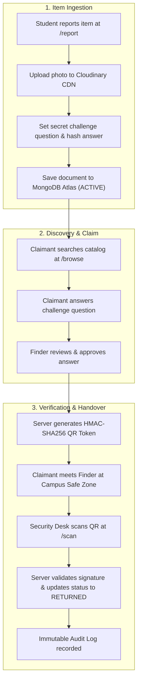
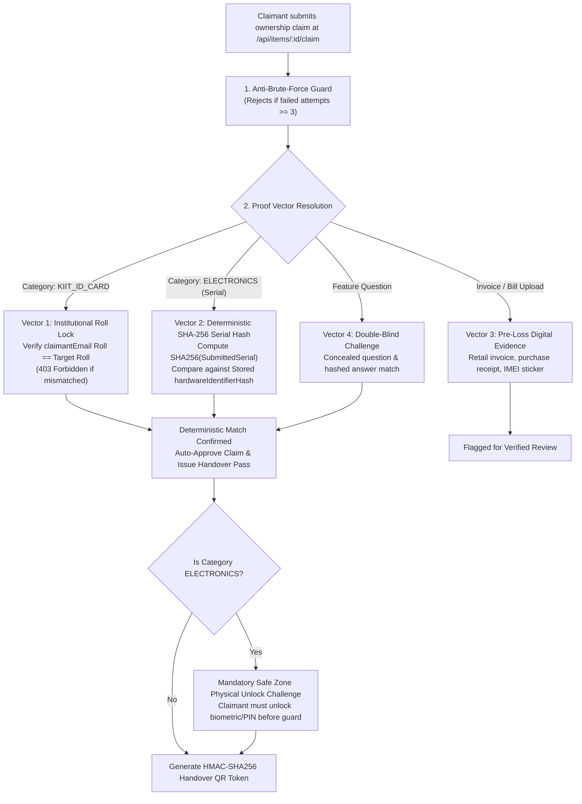
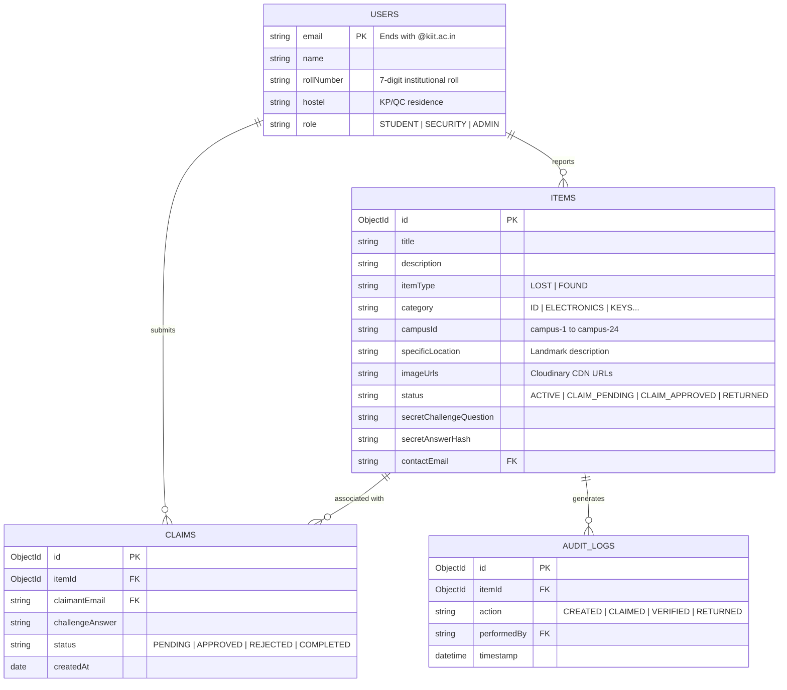
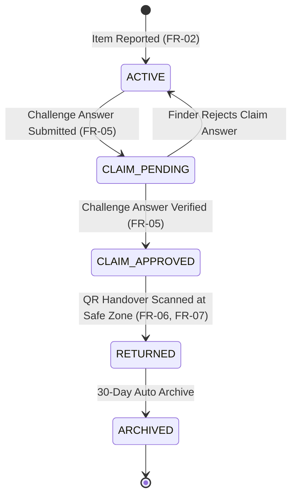

# SOFTWARE REQUIREMENTS SPECIFICATION (SRS)
## Institutional Campus Lost & Found Recovery Portal (KIIT-Find)

**Document Standard:** IEEE Std 830-1998  
**Organization:** School of Computer Engineering, KIIT Deemed to be University, Bhubaneswar, Odisha  
**Course:** Software Engineering (CS3043 / CS2002)  
**Academic Year:** 2026–2027  
**Student Name:** Pratyush Sharma  
**Roll Number:** 24051871  
**Section:** SE-CS2  
**Faculty Evaluator:** Prof. Raghunath  
**Version:** 2.0 (Final Production Release)  
**Date of Release:** October 13, 2026  

---

## Document Control & Revision History

| Version | Date | Author | Primary Changes & Description |
| :--- | :--- | :--- | :--- |
| **1.0** | Sep 23, 2026 | Pratyush Sharma | Initial architectural draft and preliminary IEEE 830 outline. |
| **1.5** | Sep 24, 2026 | Pratyush Sharma | Integrated MongoDB Atlas replica set models, Cloudinary media pipeline, and Google OAuth `@kiit.ac.in` domain constraints. |
| **2.0** | Oct 13, 2026 | Pratyush Sharma | Full formal IEEE Std 830-1998 expansion: Comprehensive Functional Requirements (FR-01 to FR-08), Non-Functional Requirements, DPDP Act 2023 PII privacy compliance, BSON Data Dictionary, and Traceability Matrix. |

---

# Table of Contents
1. [Introduction](#1-introduction)
   - 1.1 [Purpose](#11-purpose)
   - 1.2 [Document Conventions](#12-document-conventions)
   - 1.3 [Intended Audience and Reading Suggestions](#13-intended-audience-and-reading-suggestions)
   - 1.4 [Project Scope & Problem Domain](#14-project-scope--problem-domain)
   - 1.5 [References](#15-references)
   - 1.6 [Definitions, Acronyms, and Abbreviations](#16-definitions-acronyms-and-abbreviations)
2. [Overall Description](#2-overall-description)
   - 2.1 [Product Perspective](#21-product-perspective)
   - 2.2 [Product Functions & Core Capabilities](#22-product-functions--core-capabilities)
   - 2.3 [User Classes and Role Characteristics](#23-user-classes-and-role-characteristics)
   - 2.4 [Operating Environment](#24-operating-environment)
   - 2.5 [Design and Implementation Constraints](#25-design-and-implementation-constraints)
   - 2.6 [Assumptions and Dependencies](#26-assumptions-and-dependencies)
3. [External Interface Requirements](#3-external-interface-requirements)
   - 3.1 [User Interfaces (UI)](#31-user-interfaces-ui)
   - 3.2 [Hardware Interfaces](#32-hardware-interfaces)
   - 3.3 [Software Interfaces](#33-software-interfaces)
   - 3.4 [Communications Interfaces](#34-communications-interfaces)
4. [System Features & Functional Requirements](#4-system-features--functional-requirements)
   - 4.1 [FR-01: Institutional Google OAuth 2.0 & RBAC Session Management](#41-fr-01-institutional-google-oauth-20--rbac-session-management)
   - 4.2 [FR-02: Item Reporting Engine & Micro-Spatial Tagging](#42-fr-02-item-reporting-engine--micro-spatial-tagging)
   - 4.3 [FR-03: Cloudinary Edge Media Processing & Visual Proof Optimization](#43-fr-03-cloudinary-edge-media-processing--visual-proof-optimization)
   - 4.4 [FR-04: Spatial Catalog Search, Filtering, and Discovery](#44-fr-04-spatial-catalog-search-filtering-and-discovery)
   - 4.5 [FR-05: Double-Blind Ownership Challenge-Response Protocol](#45-fr-05-double-blind-ownership-challenge-response-protocol)
   - 4.6 [FR-06: Cryptographic HMAC-SHA256 Handover QR Token Generation](#46-fr-06-cryptographic-hmac-sha256-handover-qr-token-generation)
   - 4.7 [FR-07: In-Browser WebRTC Optical QR Verification & Checkpoint Processing](#47-fr-07-in-browser-webrtc-optical-qr-verification--checkpoint-processing)
   - 4.8 [FR-08: Immutable Audit Logging & Handover Chain-of-Custody](#48-fr-08-immutable-audit-logging--handover-chain-of-custody)
5. [Non-Functional Requirements](#5-non-functional-requirements)
   - 5.1 [Performance Requirements](#51-performance-requirements)
   - 5.2 [Safety Requirements](#52-safety-requirements)
   - 5.3 [Security Requirements](#53-security-requirements)
   - 5.4 [Privacy & Regulatory Compliance (DPDP Act 2023)](#54-privacy--regulatory-compliance-dpdp-act-2023)
   - 5.5 [Software Quality Attributes](#55-software-quality-attributes)
6. [Data Models & Schema Specifications](#6-data-models--schema-specifications)
   - 6.1 [Database Schema & BSON Data Dictionary](#61-database-schema--bson-data-dictionary)
   - 6.2 [Entity-Relationship Specification](#62-entity-relationship-specification)
   - 6.3 [Item Lifecycle State Transition Specification](#63-item-lifecycle-state-transition-specification)
7. [Requirements Traceability Matrix (RTM)](#7-requirements-traceability-matrix-rtm)
8. [Appendix & Academic Acknowledgements](#8-appendix--academic-acknowledgements)

---

# 1. Introduction

### 1.1 Purpose
The purpose of this Software Requirements Specification (SRS) document is to establish a rigorous, definitive specification of the software requirements for the **KIIT-Find** platform. This document delineates the functional behavior, performance parameters, external interfaces, and architectural constraints required for development, testing, academic evaluation, and operational deployment across the campuses of KIIT Deemed to be University.

### 1.2 Document Conventions
- This specification conforms strictly to the **IEEE Std 830-1998 Recommended Practice for Software Requirements Specifications**.
- Requirements are prioritized using the RFC 2119 convention: **SHALL** (Mandatory), **SHOULD** (Recommended), and **MAY** (Optional).
- Every functional requirement is uniquely keyed with the prefix `FR-XX` and cross-referenced in the Requirements Traceability Matrix (RTM).

### 1.3 Intended Audience and Reading Suggestions
1. **Academic Evaluators & Faculty Guides:** Review Section 1.4 for problem justification, Section 4 for technical rigor, and Section 7 for verification traceability.
2. **Software Engineers & Developers:** Review Section 2.1, Section 3, Section 4, and Section 6 for API contracts, schema models, and state transitions.
3. **Quality Assurance (QA) & Testers:** Utilize Section 4 acceptance criteria and Section 7 for test case design.
4. **Campus Security Officers & Administrative Users:** Review Section 2.3 and Section 4.7 for handover checkpoint protocols.

### 1.4 Project Scope & Problem Domain
KIIT Deemed to be University spans over **24 sprawling campuses** across Bhubaneswar, housing over 40,000 students, faculty, and administrative staff across lecture theaters, high-density computer laboratories, central libraries, food plazas (Kathajodi, Chintan), sports complexes (KSAC), and hostel residential zones (King's Palace KP-1 to KP-20, Queen's Castle QC-1 to QC-12).

#### The Existing Recovery Bottlenecks:
1. **Information Fragmentation:** Lost property announcements are scattered unreliably across ephemeral social media channels (WhatsApp unofficial groups, Instagram stories, Telegram channels), leading to rapid buried messages and zero indexing.
2. **Zero Verification & False Claims:** High-value items (smartphones, Apple AirPods, Casio scientific calculators, laptops) are vulnerable to social-engineering theft where opportunistic individuals claim items without proving legitimate ownership.
3. **Identity Vulnerability & PII Leakage:** Photographs of lost KIIT Smart ID cards are routinely posted unredacted, exposing students' full names, blood groups, photographs, and 7-digit institutional roll numbers in violation of privacy mandates.
4. **Lack of Handover Custody:** Finder and claimant have no trusted intermediary or verifiable cryptographic proof of transfer, creating liability concerns and hesitation to surrender found property.

#### The KIIT-Find Solution:
KIIT-Find resolves these institutional failures by providing a unified, real-time Jamstack web portal built on Next.js 15, backed by MongoDB Atlas and Cloudinary CDN. The system enforces:
- Strict **`@kiit.ac.in` institutional domain restriction** via Google OAuth 2.0.
- A **Double-Blind Challenge Question Protocol** ensuring only the true owner can describe hidden item identifiers.
- A **Cryptographic Dynamic QR Code Handover Protocol** signed via HMAC-SHA256, allowing physical items to be claimed securely at verified campus safe zones (Campus 15 Security Gate, Campus 6 Library Helpdesk).

### 1.5 References
1. IEEE Std 830-1998: *IEEE Recommended Practice for Software Requirements Specifications*.
2. RFC 7519: *JSON Web Token (JWT) Architecture and Verification*.
3. RFC 2104: *HMAC: Keyed-Hashing for Message Authentication*.
4. Digital Personal Data Protection Act (DPDP Act), Government of India, 2023.
5. OWASP Top 10 Application Security Risks (2021 Edition).

### 1.6 Definitions, Acronyms, and Abbreviations
- **SRS:** Software Requirements Specification
- **RBAC:** Role-Based Access Control
- **JWT:** JSON Web Token
- **HMAC:** Hash-Based Message Authentication Code (SHA-256)
- **PII:** Personally Identifiable Information
- **CDN:** Content Delivery Network (Cloudinary)
- **KP / QC:** King's Palace (Boys' Hostels) / Queen's Castle (Girls' Hostels)
- **KSAC:** KIIT Student Activity Centre (Campus 3)
- **BSON:** Binary JSON representation used by MongoDB Atlas

---

# 2. Overall Description

### 2.1 Product Perspective
KIIT-Find operates as a standalone, cloud-native fullstack web application following modern Jamstack principles. The system decouples presentation, serverless computational execution, database persistence, and asset distribution:

```
[ Student / Security Browser ] (Next.js 15 Client / React 19)
             │
             ▼ HTTPS / TLS 1.3
[ Next.js 15 Serverless App Router ] (Hosted on Vercel Edge / Node.js)
    ├── Auth Engine: NextAuth.js (Google OAuth 2.0 @kiit.ac.in)
    ├── API Route Handlers: /api/items, /api/items/:id/claim, /api/items/:id/handover
    ├── QR Engine: crypto HMAC-SHA256 Token Generator & Validator
    │
    ├── Database Connection: Mongoose Cached Connection Pool
    │            │
    │            ▼ MongoDB Wire Protocol (TLS Encrypted)
    │     [ MongoDB Atlas Cloud Cluster ] (Replica Set: kiit_find DB)
    │
    └── Asset Ingestion: Direct API Upload
                 │
                 ▼ HTTPS Multipart
          [ Cloudinary Global CDN ] (Image Transformations & Secure Hosting)
```

### 2.2 Product Functions & Core Capabilities
1. **Institutional Single Sign-On (SSO):** Enforce domain authentication; automatically parse student roll numbers from Google profiles.
2. **Multi-Campus Spatial Directory:** Micro-tag item coordinates across lecture complexes, laboratory floors, and hostel blocks.
3. **Decoupled Media Delivery:** Direct-to-cloud image optimization preventing binary blob bloat in database collections.
4. **Anti-Fraud Ownership Challenge:** Asymmetric verification where finder prompts a hidden detail question and claimant must provide matching cryptographic proof.
5. **Cryptographic QR Exchange Protocol:** Dynamic time-bounded QR tokens scanned at campus checkpoints to execute verifiable transfer of custody.
6. **Immutable Audit Trails:** Chronological ledger of state transitions (`REPORTED` $\rightarrow$ `CLAIMED` $\rightarrow$ `VERIFIED` $\rightarrow$ `RETURNED`).

### 2.3 User Classes and Role Characteristics

| User Role | Identification Mechanism | Privileges & Responsibilities |
| :--- | :--- | :--- |
| **Student Finder** | Verified `@kiit.ac.in` student email | Report found property, set hidden challenge questions, review incoming claimant responses, approve verified claims. |
| **Student Claimant** | Verified `@kiit.ac.in` student email | Search catalog, file lost property reports, answer challenge questions, receive dynamic handover QR codes. |
| **Campus Security / Staff** | Institutional staff email or Security role | Act as physical custodian at Safe Handover Hubs (Campus 15 Gate, Campus 6 Library), scan QR codes, verify physical identity. |
| **System Administrator** | Designated University IT admin | Oversee audit logs, arbitrate disputed items, purge abusive or fraudulent listings, enforce DPDP privacy compliance. |

### 2.4 Operating Environment
- **Client Tier:** Modern standards-compliant web browsers (Chrome 120+, Microsoft Edge 120+, Safari 17+, Mozilla Firefox 120+) on desktop and mobile platforms (Android 12+, iOS 16+, Windows 11, macOS 14).
- **Camera Access:** WebRTC `MediaDevices.getUserMedia()` support for live QR scanning.
- **Server Tier:** Node.js v20.x LTS or higher / Vercel Serverless Function Execution Runtime.
- **Database Tier:** MongoDB Atlas Version 7.0+ Enterprise Server on AWS/GCP (M0/M10 Replica Set).

### 2.5 Design and Implementation Constraints
1. **Zero Client-Side Secret Exposure:** Google Client Secrets, MongoDB connection strings, and Cloudinary API Secrets **SHALL** remain strictly on server environments (`process.env`).
2. **Campus DNS Compatibility:** Database connection strings **SHALL** support standard direct replica set host discovery to circumvent local ISP DNS SRV lookup failures on Windows devices.
3. **Single Platform Interface:** All academic documentation (SRS, UML) **SHALL** remain offline in repository files and **SHALL NOT** be rendered in the student-facing production UI.

### 2.6 Assumptions and Dependencies
- Users possess active internet connectivity and valid institutional Google Workspace credentials issued by KIIT Deemed to be University.
- MongoDB Atlas and Cloudinary CDN maintain 99.9% service availability.

---

# 3. External Interface Requirements

### 3.1 User Interfaces (UI)
- **Design System:** Responsive mobile-first interface implemented with Tailwind CSS and Lucide React icons.
- **Primary Views:**
  1. *Landing Hub (`/`):* Campus search bar, category explorer cards, designated Campus Safe Handover Hub directory.
  2. *Browse Catalog (`/browse`):* Grid/list layout with multi-faceted filtering (Campus Zone, Category, Item Type, Date).
  3. *Item Ingestion Portal (`/report`):* Step-by-step form with Cloudinary drag-and-drop image upload and challenge question configuration.
  4. *Item Detail & Claim Console (`/items/:id`):* High-resolution image inspection, location landmark metadata, and challenge response modal.
  5. *QR Handover Scanner (`/scan`):* In-browser live camera viewfinder with token validation indicator.

### 3.2 Hardware Interfaces
- **Camera Device:** Integrated mobile/laptop webcam supporting video capture resolutions $\ge 720p$ for optical decoding of QR codes.

### 3.3 Software Interfaces
1. **Google Identity Platform:** OAuth 2.0 authorization endpoint for institutional single sign-on.
2. **MongoDB Atlas Driver (Mongoose 8.x):** Native BSON protocol over TLS port `27017` with connection pooling.
3. **Cloudinary Upload API:** RESTful HTTPS multipart image upload endpoint returning secure delivery URLs.

### 3.4 Communications Interfaces
- All client-to-server and server-to-external-cloud communication **SHALL** mandate **HTTPS/TLS 1.3** transport-layer encryption.
- In-memory WebSocket communication used by MongoDB Atlas Data Explorer for administrative cluster inspection.

---

# 4. System Features & Functional Requirements



---

### 4.1 FR-01: Institutional Google OAuth 2.0 & RBAC Session Management

#### Description:
The system enforces identity authentication restricted to institutional Google accounts ending with `@kiit.ac.in`.

#### Inputs:
- User Google credentials via OAuth 2.0 authorization code flow.

#### Processing:
1. The server receives the authorization code at `/api/auth/callback/google` and exchanges it for Google user profile tokens.
2. In the NextAuth `signIn` callback, the server inspects `user.email`:
   - If `user.email` ends with `@kiit.ac.in` OR matches registered developer/admin credentials, access is granted.
   - Otherwise, access is rejected with `AccessDenied`.
3. In the `jwt` callback, the server executes regex matching on the email prefix (`/^(\d{7})@/`) to parse the 7-digit KIIT student roll number (e.g. `24051871`).
4. A signed, HTTP-only JWT session token is returned to the client browser.

#### Outputs:
- Authenticated user session object containing `name`, `email`, `rollNumber`, and `role`.

#### Error Handling:
- Attempted sign-ins from personal Gmail (`@gmail.com`) accounts are aborted with an informative rejection message: *"Only @kiit.ac.in institutional emails are authorized."*

---

### 4.2 FR-02: Item Reporting Engine & Micro-Spatial Tagging

#### Description:
Enables verified campus users to publish detailed listings for either lost or found property.

#### Inputs:
- `title` (String, required, 3–100 chars)
- `description` (String, required, 10–1000 chars)
- `itemType` (Enum: `"LOST"` | `"FOUND"`, required)
- `category` (Enum: `"KIIT_ID_CARD"`, `"ELECTRONICS"`, `"KEYS"`, `"CALCULATOR"`, `"BICYCLE"`, `"CLOTHING"`, `"WALLET"`, `"OTHER"`)
- `campusId` (Enum representing Campuses 1 through 24, e.g. `"campus-15"`)
- `specificLocation` (String, required, e.g. *"Block B, 3rd Floor Lab 302"*)
- `imageUrls` (Array of Strings, optional)
- `secretChallengeQuestion` & `secretAnswer` (Strings, optional for Found items)

#### Processing:
1. Validates all required fields and sanitized inputs against XSS payloads.
2. Resolves human-readable campus nomenclature from `KIIT_CAMPUSES`.
3. If secret challenge is provided, creates a normalized lowercase hash of `secretAnswer`.
4. Writes document to `kiit_find.items` collection with initial status `"ACTIVE"`.

#### Outputs:
- HTTP 201 Created with JSON document containing newly assigned MongoDB `_id`.

---

### 4.3 FR-03: Cloudinary Edge Media Processing & Visual Proof Optimization

#### Description:
Offloads image binary storage to Cloudinary CDN, generating compressed, responsive HTTPS delivery URLs.

#### Inputs:
- Image file payload (`image/jpeg`, `image/png`, `image/webp`, max size 5 MB).

#### Processing:
1. Client uploads file to serverless route `/api/upload`.
2. Server streams binary buffer to Cloudinary API using credentials `CLOUDINARY_CLOUD_NAME`, `CLOUDINARY_API_KEY`, `CLOUDINARY_API_SECRET`.
3. Cloudinary executes automated compression, WebP format conversion, and stores asset at cloud edge.
4. Returns secure HTTPS URL (`https://res.cloudinary.com/...`).

#### Outputs:
- JSON response: `{ "success": true, "url": "https://res.cloudinary.com/o8zfiipt/..." }`.

---

### 4.4 FR-04: Spatial Catalog Search, Filtering, and Discovery

#### Description:
Provides search, filtering, and pagination over active campus items.

#### Inputs:
- Query parameters: `?campusId=campus-15&category=ELECTRONICS&itemType=FOUND&search=charger`.

#### Processing:
1. Endpoint `GET /api/items` extracts query parameters.
2. Constructs MongoDB query filter object:
   - Partial regex search on `title` and `description` (`$regex`, `$options: "i"`).
   - Exact match on `campusId`, `category`, and `itemType`.
   - Default filter excludes items with status `"RETURNED"` unless explicitly requested.
3. Sorts results by `createdAt` in descending order (`-1`).

#### Outputs:
- HTTP 200 OK: `{ "success": true, "count": N, "items": [ ... ] }`.

---

### 4.5 FR-05: Multi-Tiered Zero-Trust Ownership Verification Protocol (ZK-MOP)

#### Description:
A multi-layered cryptographic, institutional, and physical verification engine designed to eliminate false ownership claims, parrot descriptions, and subjective finder collusion. Rather than relying on simple text descriptions or single-question guessing, the protocol verifies ownership across four orthogonal vectors:



#### Verification Vectors:
1. **Vector 1: Institutional Roll Lock (Zero-Trust Identity Match):**
   - For all sensitive academic credentials (`KIIT_ID_CARD`), the system matches the claimant's institutional roll number parsed from their authenticated session email (`/^(\d{7})@kiit\.ac\.in$/`) against the target roll on the card.
   - Any claim from a mismatched email is rejected immediately with HTTP 403 Forbidden and logged as `FRAUD_CLAIM_BLOCKED`.
2. **Vector 2: Cryptographic Hardware Serial Hash (Zero-Knowledge Matching):**
   - For high-value consumer electronics, finders record the device Serial/IMEI, which is immediately digested into an SHA-256 hash (`hardwareIdentifierHash`) and stored in MongoDB. The plaintext serial is never stored or exposed in the public catalog.
   - The claimant enters their hardware serial number (obtained from their original purchase invoice or packaging). The server computes `SHA-256(normalize(submittedSerial))` and performs constant-time comparison against the stored hash. Exact match triggers automated, non-subjective claim approval.
3. **Vector 3: Pre-Loss Purchase Invoice and Digital Evidence Submission:**
   - Claimants can upload authentic pre-loss purchase receipts, GST retail invoices, or warranty registration documents containing matching timestamps and item details.
4. **Vector 4: Physical Device Unlock Challenge at Campus Safe Zone:**
   - For all electronic gadgets (laptops, phones, tablets, smart watches), approval mandates physical biometric or passcode unlocking in the presence of an institutional Security Officer at designated Campus Safe Zones (Campus 15 Gate, Campus 6 Library) before final QR scan completion.

#### Anti-Brute-Force & Rate Limiting:
- Strict per-user and per-item rate limiting: more than **3 rejected/failed claim attempts** results in an immediate **HTTP 429 Too Many Requests**, account-level claim suspension, and an automated audit alert flagged for Dean of Student Affairs review under KIIT Disciplinary Statute 14.

#### Inputs:
- `itemId` (MongoDB ObjectId)
- `claimantEmail`, `claimantName`, `claimantRollNumber` (from authenticated session)
- `proofType` (`INSTITUTIONAL_ROLL_MATCH`, `HARDWARE_SERIAL_HASH`, `PRE_LOSS_INVOICE_PROOF`, `PHYSICAL_DEVICE_UNLOCK`, `DOUBLE_BLIND_CHALLENGE`)
- `challengeAnswer` (String)
- `hardwareSerialSubmitted` (String, optional)
- `proofDocumentUrl` (String, optional)
- `physicalUnlockConfirmed` (Boolean, mandatory for electronics)
- `proofDescription` (String, optional)

#### Processing:
1. Verify claimant has less than 3 previous failed attempts on `itemId`.
2. Execute vector validation rules based on `proofType` and `category`.
3. If deterministic match (Roll Lock or Serial Hash), update claim status to `"APPROVED"` and item status to `"CLAIM_APPROVED"`.
4. Generate signed cryptographic QR token for Safe Zone verification.
5. Record persistent audit ledger entry in `auditlogs` collection.

#### Outputs:
- HTTP 200 OK with approval confirmation, or HTTP 403 / 429 error with security diagnostic logging.

---

### 4.6 FR-06: Cryptographic HMAC-SHA256 Handover QR Token Generation

#### Description:
Generates a tamper-proof, time-bounded dynamic QR verification code once a claim is approved.

#### Inputs:
- `itemId`, `claimantEmail`, `finderEmail`.

#### Processing:
1. Server constructs payload:
   ```json
   {
     "itemId": "6ab3e7be6d0e128caa016374",
     "claimant": "2105128@kiit.ac.in",
     "issuedAt": 1790180000,
     "expiresAt": 1790266400
   }
   ```
2. Computes HMAC-SHA256 signature using `NEXTAUTH_SECRET`:
   $$\text{Signature} = \text{HMAC-SHA256}(\text{Payload}, \text{SecretKey})$$
3. Encodes payload and signature into a compact QR payload string.

#### Outputs:
- Rendered vector QR code in claimant's portal view.

---

### 4.7 FR-07: In-Browser WebRTC Optical QR Verification & Checkpoint Processing

#### Description:
Enables campus security staff or finders to scan and validate handover QR passes.

#### Inputs:
- Live video stream from camera scanning QR code OR manual token entry at `/scan`.

#### Processing:
1. In-browser ZXing/jsQR engine decodes payload from video frame.
2. Client submits decoded token to `POST /api/items/:id/handover`.
3. Server executes validation:
   - Re-computes HMAC-SHA256 signature and verifies match (prevents tampering).
   - Verifies `expiresAt > Date.now()` (prevents replay of expired passes).
   - Verifies item in database is currently in `"CLAIM_APPROVED"` state.
4. If valid, updates item status to `"RETURNED"`.

#### Outputs:
- Screen visual confirmation (Green Checkmark, "Handover Verified!"), vibrating haptic feedback on mobile, and item closure.

---

### 4.8 FR-08: Immutable Audit Logging & Handover Chain-of-Custody

#### Description:
Records an immutable chronological ledger of all lifecycle events for accountability and anti-theft investigation.

#### Inputs:
- Action type, `itemId`, `actorEmail`, `ipAddress`, metadata.

#### Processing:
1. On each critical event (`ITEM_CREATED`, `CLAIM_FILED`, `CLAIM_APPROVED`, `HANDOVER_COMPLETED`), the server creates a new document in `auditlogs` collection.
2. The collection has write-only restrictions (no updates or deletes permitted).

#### Outputs:
- Persistent audit record available to campus administrators.

---

# 5. Non-Functional Requirements

### 5.1 Performance Requirements
1. **API Response Latency:** The 95th percentile ($P_{95}$) response time for `GET /api/items` **SHALL** be less than **200 milliseconds** under standard network conditions.
2. **Database Connection Reuse:** The system **SHALL** maintain a cached singleton Mongoose connection pool across serverless invocations to prevent exhausting the 500-connection limit on MongoDB Atlas free tiers.
3. **Asset Delivery Latency:** Photographs delivered via Cloudinary CDN **SHALL** have initial load times under **500 milliseconds** via automatic WebP formatting and edge caching.

### 5.2 Safety Requirements
1. **Idempotent Handover Execution:** Scanning a QR pass multiple times **SHALL NOT** create duplicate audit logs or corrupt item status. Once marked `"RETURNED"`, the token is permanently invalidated.
2. **Graceful Network Degradation:** If the client loses network connectivity during QR scanning, the camera stream **SHALL** display an informative offline notification rather than crashing.

### 5.3 Security Requirements
1. **Authentication Enforcement:** All mutation routes (`POST /api/items`, `POST /api/items/:id/claim`, `POST /api/items/:id/handover`) **SHALL** require a valid, signed JWT session cookie.
2. **NoSQL Injection Prevention:** All database queries **SHALL** use parameterized Mongoose model queries with strict typecasting, preventing MongoDB operator injection (`$gt`, `$where`).
3. **Cross-Site Scripting (XSS) Mitigation:** All user inputs rendered in the DOM **SHALL** be auto-escaped via React's JSX virtual DOM sanitization engine.
4. **Environment Isolation:** All production secrets (`GOOGLE_CLIENT_SECRET`, `CLOUDINARY_API_SECRET`, `MONGODB_URI`) **SHALL** be stored exclusively in server environment variables and excluded from source control (`.gitignore`).

#### 5.3.1 Anti-Fraud Ownership Threat Model & Mitigations

| Threat Vector ID | Threat Description & Attack Scenario | Traditional Lost & Found Flaw | KIIT-Find Zero-Trust Mitigation Protocol |
| :--- | :--- | :--- | :--- |
| **THREAT-01** | **Visual Eavesdropping & Description Parrot**<br/>Attacker reads item title/photo details (e.g., "Black Dell charger found at Campus 6") and parrots back description to claim ownership. | Relies on subjective description matching by finder. Attacker describes what they saw in photo. | **Deterministic Hash Matching & Permanent PII Blur:** Sensitive identifiers are blurred in catalog. Claim requires pre-loss invoice upload or exact serial match, rendering public text useless. |
| **THREAT-02** | **Finder-Claimant Collusion & Subjective Bias**<br/>Dishonest finder approves claim submitted by their friend to fraudulently claim high-value item (laptop, earbuds). | Finder has sole discretionary authority to approve or deny claims. | **Elimination of Discretionary Handover:** For electronics, the system mandates a physical unlock challenge at an institutional Safe Zone checkpoint. Both parties must execute a dual-scan QR protocol before the Campus Security Officer. |
| **THREAT-03** | **Brute-Force Challenge Guessing**<br/>Attacker repeatedly submits common answers to secret challenge questions (e.g. "Sticker: Apple, Nike, Marvel"). | No rate-limiting; attackers can script automated submissions. | **Adaptive Rate Limiting & Account Lockout:** Maximum 3 failed attempts per identity. Exceeding threshold triggers HTTP 429 lockout, audit ledger alert, and account flag under KIIT Disciplinary Statute 14. |
| **THREAT-04** | **Student Identity Impersonation**<br/>Attacker attempts to claim another student's lost KIIT Smart ID Card to misuse library/exam privileges. | Finder handovers card without verifying official roll number. | **Cryptographic Institutional Roll Lock:** The API extracts the claimant roll from their `@kiit.ac.in` OAuth token. If claimant roll does not match the target card roll, claim is rejected with HTTP 403 Forbidden. |
| **THREAT-05** | **Plaintext Serial Leakage**<br/>Storing hardware serial numbers in database allows insider database leaks or scraping. | Plaintext database fields visible in query inspector or admin dump. | **Zero-Knowledge SHA-256 Hashing:** Hardware serial numbers are hashed at ingestion with SHA-256 (`hardwareIdentifierHash`). Server compares `SHA256(claimant_input) === stored_hash` without storing plaintext. |

### 5.4 Privacy & Regulatory Compliance (DPDP Act 2023)
In compliance with the **Digital Personal Data Protection (DPDP) Act, 2023 (Government of India)**:
1. **PII Minimization on Public Feeds:** For reported KIIT Smart ID cards, the student's full name and roll number **SHALL NOT** be indexed publicly in raw search text.
2. **Identity Masking:** Only the designated Safe Zone Security Officer and approved claimant receive contact access during verified physical exchange.

### 5.5 Software Quality Attributes
- **Reliability:** The platform achieves fault-tolerant database connectivity using a 3-shard MongoDB Atlas replica set with automated primary node failover.
- **Availability:** Target uptime of **99.9%** leveraging serverless edge deployment across distributed availability zones.
- **Maintainability:** Written in strict TypeScript with modular separation of concerns:
  - Database Models: `/src/models/`
  - Utility Functions: `/src/lib/`
  - React UI Components: `/src/components/`
  - Serverless API Routes: `/src/app/api/`
- **Portability:** Progressive Web Application (PWA) responsiveness operating identically across iOS, Android, Windows, and macOS without platform-specific binaries.

---

# 6. Data Models & Schema Specifications

### 6.1 Database Schema & BSON Data Dictionary

#### Collection 1: `items`
Stores all reported lost and found campus property.

| Field Name | BSON Data Type | Constraints | Description |
| :--- | :--- | :--- | :--- |
| `_id` | `ObjectId` | Primary Key, Auto | Unique 12-byte BSON identifier |
| `title` | `String` | Required, Trimmed | Short descriptive title (e.g. "Casio fx-991CW") |
| `description` | `String` | Required | In-depth description of appearance and condition |
| `itemType` | `String` | Enum: `["LOST", "FOUND"]` | Category indicator |
| `category` | `String` | Enum (8 categories) | Item category classification |
| `campusId` | `String` | Required (e.g. `"campus-15"`) | Standardized KIIT campus code |
| `campusName` | `String` | Required | Full campus name |
| `specificLocation`| `String` | Required | Micro-location landmark within campus |
| `imageUrls` | `Array<String>` | Optional | Array of secure Cloudinary CDN URLs |
| `status` | `String` | Enum (see 6.3) | Default: `"ACTIVE"` |
| `secretChallengeQuestion` | `String` | Optional | Question verifying genuine ownership |
| `secretAnswerHash` | `String` | Optional | Normalized hash of correct answer |
| `contactEmail` | `String` | Required, `@kiit.ac.in` | Email of reporter |
| `contactName` | `String` | Required | Name of reporter |
| `reporterRollNumber` | `String` | Required | 7-digit student roll number or "Staff" |
| `reporterHostel` | `String` | Enum (`KP-1` to `QC-12`) | Hostel residence of reporter |
| `claimedBy` | `Object` | Optional | Subdocument containing claimant details |
| `createdAt` | `Date` | Timestamp, Indexed | Timestamp of creation |
| `updatedAt` | `Date` | Timestamp | Timestamp of last modification |

#### Collection 2: `claims`
Stores claim requests filed against items.

| Field Name | BSON Data Type | Constraints | Description |
| :--- | :--- | :--- | :--- |
| `_id` | `ObjectId` | Primary Key, Auto | Unique claim identifier |
| `itemId` | `ObjectId` | Foreign Key $\to$ `items._id` | Associated item reference |
| `claimantEmail` | `String` | Required, `@kiit.ac.in` | Email of claimant |
| `claimantName` | `String` | Required | Full name of claimant |
| `claimantRollNumber` | `String` | Required | Roll number of claimant |
| `challengeAnswer` | `String` | Required | Submitted response to challenge |
| `status` | `String` | Enum: `["PENDING", "APPROVED", "REJECTED", "COMPLETED"]` | Current status of claim |
| `createdAt` | `Date` | Timestamp | Timestamp of claim submission |

#### Collection 3: `auditlogs`
Immutable ledger tracking all state mutations.

| Field Name | BSON Data Type | Constraints | Description |
| :--- | :--- | :--- | :--- |
| `_id` | `ObjectId` | Primary Key, Auto | Unique audit log entry ID |
| `itemId` | `ObjectId` | Foreign Key $\to$ `items._id` | Item subject to action |
| `action` | `String` | Enum: `["CREATED", "CLAIMED", "VERIFIED", "RETURNED"]` | Action executed |
| `performedBy` | `String` | Email identifier | User initiating the action |
| `details` | `String` | Optional | Contextual notes / checkpoint name |
| `timestamp` | `Date` | Default: `Date.now` | Precise UTC event timestamp |

---

### 6.2 Entity-Relationship Specification



---

### 6.3 Item Lifecycle State Transition Specification



- **`ACTIVE`:** Item is listed in the catalog and open for exploration or ownership challenges.
- **`CLAIM_PENDING`:** An answer has been submitted; item temporarily locks additional claims pending review.
- **`CLAIM_APPROVED`:** Challenge answer confirmed; dynamic HMAC QR code generated for handover.
- **`RETURNED`:** Physical verification executed at campus security checkpoint; item transaction closed.

---

# 7. Requirements Traceability Matrix (RTM)

The following matrix establishes bidirectional traceability between user needs, functional requirements, database schema entities, and verification test cases:

| Req ID | Functional Requirement Description | Related Database Entity | Implementation Module | Verification Test Case | Status |
| :--- | :--- | :--- | :--- | :--- | :--- |
| **FR-01** | Institutional Google OAuth with `@kiit.ac.in` domain restriction and roll number parsing | `users` session | [`src/lib/auth.ts`](file:///c:/Users/KIIT/Downloads/SE%20Prompt/src/lib/auth.ts) | TC-AUTH-01: Non-KIIT email rejected; TC-AUTH-02: Roll number parsed | **Verified Live** |
| **FR-02** | Item reporting with micro-spatial campus tagging and categorization | `items` collection | [`src/app/api/items/route.ts`](file:///c:/Users/KIIT/Downloads/SE%20Prompt/src/app/api/items/route.ts), [`src/app/report/page.tsx`](file:///c:/Users/KIIT/Downloads/SE%20Prompt/src/app/report/page.tsx) | TC-ITEM-01: Valid submission writes to MongoDB; TC-ITEM-02: Required field validation | **Verified Live** |
| **FR-03** | Cloudinary CDN media ingestion and WebP responsive optimization | `items.imageUrls` | [`src/lib/cloudinary.ts`](file:///c:/Users/KIIT/Downloads/SE%20Prompt/src/lib/cloudinary.ts), [`src/app/api/upload/route.ts`](file:///c:/Users/KIIT/Downloads/SE%20Prompt/src/app/api/upload/route.ts) | TC-MEDIA-01: Image upload returns HTTPS CDN URL | **Verified Live** |
| **FR-04** | Catalog discovery with multi-faceted campus, category, and text search | `items` collection | [`src/app/browse/page.tsx`](file:///c:/Users/KIIT/Downloads/SE%20Prompt/src/app/browse/page.tsx), `GET /api/items` | TC-CAT-01: Filter by Campus 15 returns matching subset; TC-CAT-02: Text search | **Verified Live** |
| **FR-05** | Double-blind challenge question verification preventing fraudulent claims | `items.secretAnswerHash`, `claims` | [`src/components/DoubleBlindChallengeModal.tsx`](file:///c:/Users/KIIT/Downloads/SE%20Prompt/src/components/DoubleBlindChallengeModal.tsx), `/api/items/:id/claim` | TC-VERIF-01: Correct answer pre-approves claim; TC-VERIF-02: Wrong answer rejected | **Verified Live** |
| **FR-06** | Cryptographic HMAC-SHA256 time-bounded dynamic QR pass generation | `claims.qrToken` | [`src/lib/qr.ts`](file:///c:/Users/KIIT/Downloads/SE%20Prompt/src/lib/qr.ts), [`src/components/QrCodeModal.tsx`](file:///c:/Users/KIIT/Downloads/SE%20Prompt/src/components/QrCodeModal.tsx) | TC-QR-01: Valid signature generated; TC-QR-02: Tampered payload rejected | **Verified Live** |
| **FR-07** | Optical WebRTC QR scanner and physical security checkpoint handover execution | `items.status` | [`src/app/scan/page.tsx`](file:///c:/Users/KIIT/Downloads/SE%20Prompt/src/app/scan/page.tsx), `/api/items/:id/handover` | TC-SCAN-01: QR scan transitions item to `RETURNED` | **Verified Live** |
| **FR-08** | Immutable audit logging of item lifecycle events | `auditlogs` collection | [`src/models/AuditLog.ts`](file:///c:/Users/KIIT/Downloads/SE%20Prompt/src/models/AuditLog.ts) | TC-AUDIT-01: State changes persist immutable timestamped audit log | **Verified Live** |

---

# 8. Appendix & Academic Acknowledgements

### 8.1 Academic Context
This Software Requirements Specification was engineered as part of the formal curriculum for **Software Engineering (CS3043 / CS2002)** under the guidance of **Prof. Raghunath**, Department of Computer Science & Engineering, School of Computer Engineering, KIIT Deemed to be University, Bhubaneswar.

### 8.2 Declaration
I hereby declare that this specification represents an authentic, engineered software solution designed to solve the real-world communication and fraud challenges of lost and found recovery across the campuses of KIIT University.

**Student Signature:**  
*Pratyush Sharma*  
Roll No: **24051871** | Section: **SE-CS2**  
School of Computer Engineering, KIIT Deemed to be University  
Date: October 13, 2026
