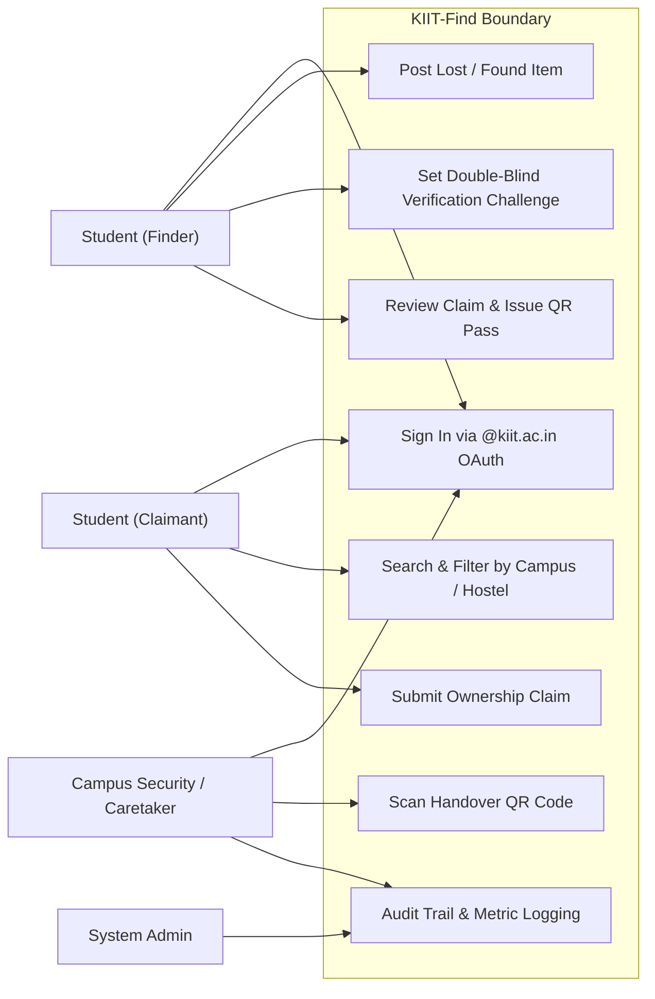
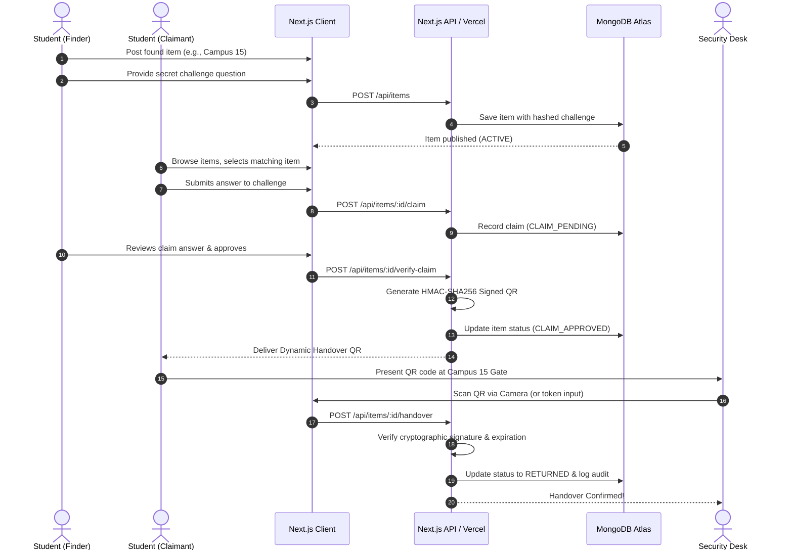
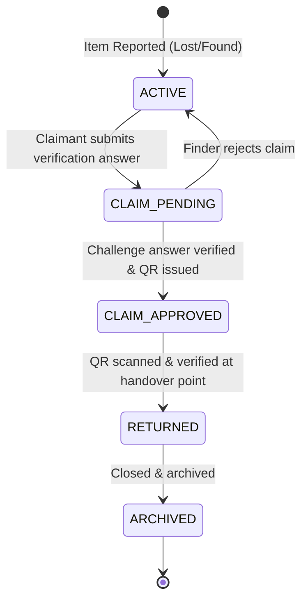
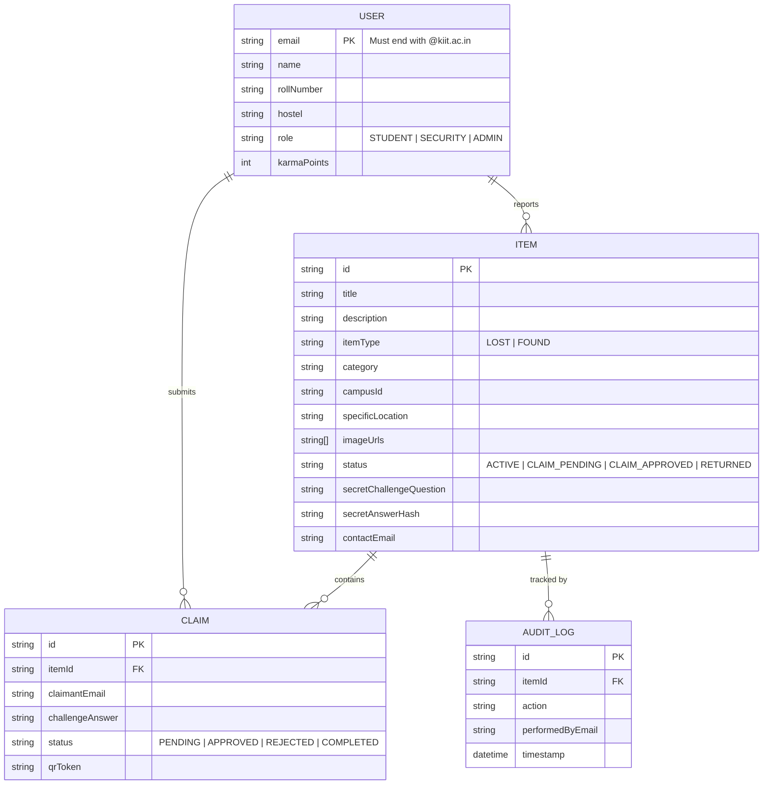

# UML Diagrams: KIIT-Find Campus Portal

---

## 1. Use Case Diagram

---

## 2. Sequence Diagram: Claim & Handover Lifecycle

---

## 3. State Machine Diagram: Item Lifecycle

---

## 4. Entity-Relationship Diagram (ERD)

